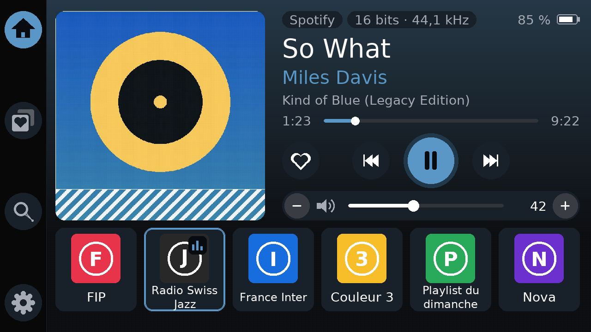
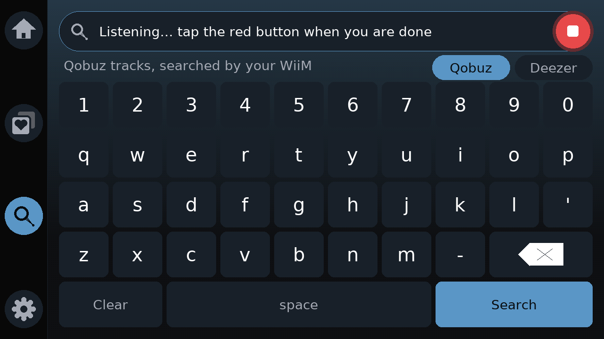

# wiimscreen — télécommande WiiM sur ESP32

*English: [README.md](README.md)*

Firmware libre (MIT) pour cartes ESP32 à écran tactile, qui pilote un streamer WiiM sur le réseau local et affiche ce
qui est en cours de lecture. **Pour l'instant, seul le M5Stack Tab5** (ESP32-P4, écran tactile couleur 5" 1280×720)
**a été testé** : c'est la carte prise en charge, et celle de ce guide. Le portage vers d'autres cartes ESP32 est
décrit dans [docs/DEVELOPERS.md](docs/DEVELOPERS.md#other-esp32-boards) (en anglais).

La même application existe aussi sur ordinateur, à titre expérimental : Raspberry Pi, Linux, macOS, et **Windows**
(un simple portage pour l'instant : `wiimscreen.exe` à dézipper, sans installateur ni signature ; essayé avec un
WiiM Pro sous Windows 11). Sur ordinateur, on peut taper la recherche au clavier et se déplacer avec les flèches,
une télécommande ou une manette. Voir [docs/DESKTOP.md](docs/DESKTOP.md) (en anglais).

> **Langue** : l'interface est en anglais par défaut. Pour l'avoir en français : page de configuration (sur le
> téléphone) › **Language / Langue** › **Français**, puis **Save and restart**. Les noms de boutons de ce guide sont
> ceux de l'interface en français. Le Journal reste en français dans les deux langues.

> **Version bêta (la 1.0 arrive).** Seul le M5Stack Tab5 est testé ; les versions pour ordinateur restent expérimentales.



- **En cours de lecture** : grande pochette ; à côté, source et qualité audio en pastilles (« Spotify », « 16 bits · 44,1 kHz », « EN DIRECT » pour une radio), titre, artiste, album, progression, lecture/pause et volume regroupés près de ce qu'ils commandent
- **Couleurs tirées de la pochette** : la lueur du fond, le bouton lecture et les barres prennent la teinte dominante de l'album
- **Presets en tuiles** (image + nom) repris automatiquement du WiiM, par pages de 6 (glisser pour changer de page) ; sans image, des initiales sur une couleur propre à chaque preset. Le preset en cours est entouré et marqué d'une petite icône d'égaliseur. Les tuiles d'albums montrent l'artiste (titre sans « (Remastered) », « (Deluxe Edition) »…). Les dernières tuiles lancées passent en tête (après une minute sans appui, pour que rien ne bouge sous le doigt) ; doigt tenu sur une tuile : la noter (1 à 5 étoiles), l'épingler en tête ou la retirer des favoris. Réglage « Ordre des tuiles » dans la configuration pour garder l'ordre enregistré
- **Retours visuels** : anneau qui tourne autour du bouton lecture pendant le chargement d'un preset, notifications posées sur la pochette sans cacher le titre, commandes grisées quand le WiiM est injoignable
- **Recherche à la voix** (facultative) : sur l'écran de recherche, touche le micro dans le champ, dis un artiste, un morceau ou un album, puis touche le bouton rouge : le texte s'écrit et la recherche part (Qobuz ou Deezer)
- **Gestes directs** : toucher ou glisser sur la barre de volume règle le volume, maintenir − ou + le change pas à pas, toucher la barre de progression avance ou recule dans le morceau, toucher le haut-parleur coupe le son
- **Vue ambiance** : après 60 s sans appui pendant la lecture, ou tout de suite avec le bouton plein écran (à droite des commandes), grande pochette et grands textes, lisibles de loin ; un appui ramène les commandes
- **Visualiseur** (expérimental, à activer dans la configuration) : en vue ambiance, un spectre animé suit la musique, capté par les micros du Tab5. Le son est analysé sur place (24 bandes de fréquence) : rien n'est enregistré ni envoyé. Le micro ne fonctionne qu'en vue ambiance
- **Réveil par mouvement** : soulever ou déplacer le Tab5 rallume l'écran et affiche les commandes ; les petites vibrations (enceinte sur le même meuble) sont ignorées

  

- **Économie d'écran** : atténué après 10 min sans appui, éteint après 20 min si rien ne joue ; un appui le rallume
- **Sons** par le haut-parleur : un clic à chaque appui, deux notes graves si le WiiM ne répond pas, deux notes aiguës quand l'appui long ouvre la configuration (réglable ou désactivé)
- **Aucune appli à installer** : tout se règle depuis un téléphone, via un portail Wi-Fi affiché à l'écran (avec QR code)
- **API locale du WiiM** (`httpapi.asp`), aucun cloud
- **TLS épinglé** : le certificat auto-signé du WiiM est enregistré à la première connexion, puis comparé (SHA-256) avant chaque requête
- **Réglages conservés** lors des mises à jour du firmware (mémoire NVS), et même après un flash USB complet (le Tab5 en garde une copie et la remet)

## 1. Obtenir le firmware

Télécharge `wiim-remote-tab5.bin` depuis la [dernière version publiée](../../releases) (fichier non zippé). Les
versions de test sont aussi dans l'onglet **Actions** > dernière exécution > artefact **wiim-remote-tab5** (à dézipper).

## 2. Flasher en USB (une seule fois)

Ensuite, les mises à jour passent par le Wi-Fi (section 5). Rien à installer :

1. Ouvre **Chrome ou Edge** (Firefox ne gère pas le port série web) sur https://esp.huhn.me/ (ESPWebTool).
2. Branche le Tab5 en USB-C (câble **de données**). Appuie une fois sur le bouton d'alimentation pour l'allumer, puis maintiens-le appuyé jusqu'à ce que la LED **verte clignote** (mode téléchargement).
3. Clique **Connect** et choisis le port qui apparaît.
4. Choisis `wiim-remote-tab5.bin`, mets son *offset* à **0x0**, clique **Program**.
5. À la fin, appuie sur le bouton d'alimentation pour démarrer le Tab5.

La page web d'Espressif (esptool-js) n'existe plus (2026). Autre possibilité, en ligne de commande avec **esptool**
(Python 3.8 ou plus récent ; sous Windows, remplace `python3` par `py`) : `python3 -m pip install --upgrade esptool`,
Tab5 en mode téléchargement, puis `python3 -m esptool --chip esp32p4 write-flash 0x0 wiim-remote-tab5.bin`
(ajoute `--port COM5` sous Windows si le Tab5 n'est pas trouvé) ; quand esptool affiche « Hard resetting », appuie
sur le bouton d'alimentation.

Pas de batterie ? Le Tab5 fonctionne très bien branché en USB-C. La batterie (type Sony NP-F550, 7,4 V) est vendue à part ; sans elle, l'indicateur de batterie n'apparaît pas.

## 3. Configurer avec ton téléphone

Au premier démarrage, l'écran affiche « Configuration » avec un QR code.

1. Scanne le QR code (ou rejoins le Wi-Fi `WiiM-Remote-XXXX` avec le mot de passe affiché).
2. La page de configuration s'ouvre ; sinon va sur **http://192.168.4.1**.
3. Renseigne :
   - ton **Wi-Fi** (2,4 GHz) : choisis-le dans la liste et tape son mot de passe. Astuce Android : **Paramètres > Wi-Fi > ton réseau > Partager** affiche le mot de passe sous le QR code
   - l'**IP du WiiM** : **laisse vide**. Le Tab5 cherche les WiiM sur ton Wi-Fi ; il te montre ceux qu'il trouve et tu touches celui à commander (par son nom dans l'app WiiM Home), même s'il n'y en a qu'un. Si son adresse change plus tard, le Tab5 retrouve le même WiiM tout seul
   - les **presets** : laisse vide pour reprendre ceux de l'app WiiM Home (noms et images). Sinon, une ligne par bouton, `numéro=nom` (12 max) :
   ```
   1=Radio Swiss Jazz
   2=Couleur 3
   ```
4. **Enregistrer** : la télécommande redémarre, se connecte et affiche l'interface. Le premier échange enregistre le certificat du WiiM (« Certificat du WiiM enregistré »).

## 4. Recherche à la voix (facultatif)



La transcription de la voix est faite par OpenAI : le Tab5 seul ne sait pas reconnaître du français libre (le moteur hors ligne d'Espressif ne connaît que des commandes en anglais et en chinois).

1. Crée un compte sur https://platform.openai.com, ajoute quelques dollars de crédit, puis crée une clé API (*API keys* > *Create new secret key*).
2. Ouvre la configuration du Tab5 (bouton ⚙ en bas de la barre de gauche → **Configuration**) et colle la clé dans **Dictée de la recherche : clé API OpenAI**.
3. Un bouton micro apparaît dans le champ de l'écran de recherche (loupe de la barre de gauche).

**Coût** : modèle `gpt-4o-mini-transcribe`, facturé à la durée d'audio (environ 0,3 centime de dollar la minute au moment de l'écriture) ; une phrase dure quelques secondes, soit quelques centimes par mois même en usage quotidien.

**Ce qui est envoyé** : uniquement le son enregistré pendant l'écoute (8 s au plus), à OpenAI ; puis le texte cherché, au WiiM (Qobuz) ou à Deezer. Le micro est coupé le reste du temps. La clé reste dans la mémoire du Tab5 et n'est jamais réaffichée dans la page de configuration.

**Utilisation** : sur l'écran de recherche, touche le micro, attends le bip, dis un artiste, un morceau ou un album, puis touche le **bouton rouge** pour finir. Le texte entendu s'écrit dans le champ et la recherche part. 🏠 ou ⚙ abandonnent. Pendant l'écoute, la musique est baissée puis remise à son volume.

Exemples : « Stromae », « Daft Punk Discovery », « Ma meilleure ennemie ». Les résultats s'affichent comme pour une
recherche tapée au clavier ; touche celui à écouter.

**Reconfigurer plus tard** : bouton ⚙ (barre de gauche), puis **Configuration**.

## 5. Mettre à jour par le Wi-Fi

Une fois ce firmware installé par USB, les versions suivantes s'installent sans câble.

**Depuis GitHub, sans téléphone :** sur le Tab5, bouton ⚙ → **Mise à jour**. Le Tab5 cherche la dernière version publiée sur GitHub. S'il affiche « Nouvelle version », touche **Installer** : il la télécharge, vérifie sa taille et son empreinte SHA-256 (celles annoncées par GitHub), l'installe et redémarre. **Annuler** pendant le téléchargement garde la version actuelle.

**Depuis un téléphone ou un ordinateur :**

1. Télécharge `wiim-remote-tab5.bin` depuis la [dernière version publiée](../../releases).
2. Sur le Tab5 : bouton ⚙ (barre de gauche) → **Mise à jour**. L'écran affiche un QR code, une adresse (`http://192.168.x.x`) et un code à 6 chiffres.
3. Sur un téléphone ou un ordinateur du même Wi-Fi, scanne le QR code ou ouvre cette adresse, saisis le code, choisis le fichier `.bin`, **Installer**.
4. Une barre de progression s'affiche sur le téléphone (ou l'ordinateur) et sur le Tab5, puis il redémarre sur la nouvelle version (affichée en bas du menu Réglages).

La page ne répond que pendant que le Tab5 affiche l'écran Mise à jour ; le code change à chaque fois. La page ne s'ouvre pas sur le téléphone ? Coupe les données mobiles et vérifie qu'il est sur le Wi-Fi de la maison (pas un réseau invité). L'adresse doit commencer par `http://` et non `https://`. Sur iPhone avec un autre navigateur que Safari : Réglages › ce navigateur › autoriser « Réseau local ».

C'est le même fichier que pour le flash USB : le Tab5 n'en garde que la partie utile. Le nouveau firmware est écrit à côté de l'ancien et vérifié avant d'être utilisé : un fichier incomplet, pour un autre appareil ou interrompu en route laisse l'ancien en place. Une nouvelle version qui s'arrête dans ses 45 premières secondes est remplacée par la précédente au redémarrage, et le Tab5 le dit (à partir de v0.6.4-beta). Le mode mise à jour se ferme avec **Annuler** ou au bout de 10 minutes ; après un code faux, il faut attendre un peu plus à chaque fois.

## Utilisation

| Zone | Action |
|---|---|
| Barre de progression | Avancer / reculer dans le morceau |
| Barre de volume | Régler le volume directement (toucher ou glisser) |
| − / + maintenu | Changer le volume pas à pas |
| Haut-parleur (à gauche du volume) | Couper / rétablir le son |
| Tuiles du bas | Lancer le preset (au relâcher) |
| Doigt tenu sur une tuile | Menu de la tuile : note (1 à 5 étoiles ; la même étoile retouchée l'efface), épingler en tête / désépingler, retirer des favoris |
| Bibliothèque (2ᵉ bouton de la barre de gauche : deux pochettes et un cœur) | Bibliothèque : toutes les tuiles sur un écran, filtres Presets / Favoris / Qobuz / Deezer ; les tuiles notées d'abord (★ et leur note sur l'image) ; toucher une tuile la lance, doigt tenu : son menu |
| « Favoris Qobuz » / « Favoris Deezer » (Bibliothèque › Qobuz / Deezer, en premier ; plus sur la bande) | Liste des morceaux favoris : toucher un morceau, **Tout lire** ou **Aléatoire** (Deezer : pas encore vérifié sur un WiiM) |
| Glisser sur les tuiles, ou toucher les points | Page de presets suivante / précédente |
| − / + (bouts de la barre de volume) | Volume (pas réglable) |
| ◀◀ / ▶▶ | Piste précédente / suivante |
| ▶ / II | Lecture / pause |
| Cœur (à gauche de ◀◀) | Ajouter l'album ou la playlist en cours aux favoris (ou l'en retirer) |
| Plein écran (quatre coins, à droite de ▶▶) | Vue ambiance tout de suite (un appui ramène les commandes) |
| 🏠 en haut de la barre de gauche | Accueil : écran principal (première page de presets) |
| Loupe (3ᵉ bouton de la barre de gauche) | Recherche Qobuz ou Deezer : taper un artiste ou un morceau, puis toucher un résultat |
| ⚙ en bas de la barre de gauche | Réglages : configuration, mise à jour, test tactile, journal, mise en veille |
| Pochette ou titre, 3 s | Réglages (même menu) |
| Maison (en haut à droite), ou n'importe où, en vue ambiance | Revenir à l'écran principal |
| Soulever / déplacer le Tab5 | Rallumer l'écran, revenir aux commandes |

## Comment faire

**Chercher sur Qobuz.** Le WiiM doit avoir ton compte Qobuz (app WiiM Home › Qobuz). Lance une fois un album Qobuz
depuis l'app WiiM Home : le Tab5 y copie les réglages Qobuz du WiiM. Ensuite : loupe › **Qobuz** › tape un artiste
ou un morceau › **Chercher**. Compte environ 10 s : c'est le WiiM qui cherche, la musique s'arrête pendant la
recherche puis revient. Touche un résultat pour le lancer. Avec l'option **Recherche Qobuz directe**, la recherche
prend 1 s (voir [Interfaces non officielles](#interfaces-non-officielles)).

**Chercher sur Deezer.** Le WiiM doit avoir ton compte Deezer. Lance une fois un album Deezer ou Flow depuis l'app
WiiM Home. Ensuite : loupe › **Deezer** › tape un artiste ou un morceau › **Chercher**. Un résultat touché lance son
album à partir de ce morceau.

**Flow Deezer.** Lance Flow une fois depuis l'app WiiM Home : une tuile **Flow** apparaît toute seule. Elle relance
Flow avec de nouveaux morceaux. Si tu la retires, touche le cœur pendant que Flow joue pour la remettre.

**Favoris d'un profil Deezer.** Sur deezer.com, ouvre ton profil (public) et copie le numéro à la fin de l'adresse.
Colle-le dans la configuration (⚙ › **Configuration** › **Profil Deezer**). Puis Bibliothèque › **Deezer** ›
**Favoris Deezer**, ou une tuile d'album.

**Mise en veille.** ⚙ › **Mise en veille** éteint le Tab5 ; la configuration peut aussi régler une mise en veille
automatique. Le bouton d'alimentation le rallume (un appui sur l'écran ne le réveille pas).

**Tout effacer.** Page de configuration › **Avancé** › **Tout effacer** : réglages, favoris et historique des tuiles
disparaissent, le Tab5 redémarre en mode configuration.

**Version Windows.** Télécharge `wiimscreen-windows-x64.zip` depuis la dernière version publiée, dézippe-le et
lance `wiimscreen.exe` (non signé : « Informations complémentaires » › « Exécuter quand même »).

## En cas de souci

- **Une zone tactile semble décalée** : ⚙ → **Test tactile**. Un rond doit apparaître sous ton doigt ; une photo de cet écran aide beaucoup à corriger.
- **« WiiM injoignable »** : WiiM éteint ou débranché. Si seule son adresse a changé, le Tab5 le retrouve en moins de deux minutes (« WiiM retrouvé à sa nouvelle adresse »).
- **« Aucun WiiM trouvé »** au démarrage : WiiM éteint, ou sur un autre réseau (Wi-Fi invité, autre box). Certains routeurs bloquent la recherche entre appareils (« isolation des clients ») : saisis alors l'IP du WiiM dans la configuration.
- **« Certificat du WiiM inattendu »** : après une réinitialisation ou une mise à jour du WiiM, son certificat peut changer. Si c'est le cas, reconfigure et coche « Oublier le certificat enregistré ». Si rien n'a changé côté WiiM, quelqu'un s'intercale peut-être sur ton réseau : ne l'accepte pas à l'aveugle.
- **« Wi-Fi injoignable »** : touche l'écran pour rouvrir la configuration. Si le Wi-Fi ne démarre jamais, le module Wi-Fi (ESP32-C6) du Tab5 a peut-être besoin de son firmware d'origine : M5Stack fournit un guide de restauration.
- **Pas de pochette** (deux croches à la place) : la source n'en fournit pas (entrée ligne, Bluetooth, certaines radios), ou l'image est dans un format non pris en charge (WebP, JPEG progressif).
- **Le visualiseur reste plat** : le micro capte peu de son (Tab5 loin des enceintes, volume bas). La sensibilité s'adapte en quelques secondes.
- **L'écran se rallume tout seul** : le Tab5 est peut-être posé sur un meuble qui vibre fort ; désactive le réveil par mouvement dans la configuration.
- **« Clé OpenAI refusée »** : clé mal collée ou supprimée → recolle-la dans la configuration. **« Quota OpenAI dépassé »** : plus de crédit sur le compte OpenAI.
- **« Je n'ai rien entendu »** : parle plus près du Tab5 ; si la musique est très forte, baisse-la d'abord.
- **Pas de favoris Deezer** : indique le numéro de ton profil Deezer dans la configuration (**Profil Deezer**) ; ton profil doit être public. Un lien court (`link.deezer.com/…`) ne contient pas le numéro : ouvre-le d'abord dans un navigateur. Le Journal (lignes « Deezer : » et « Favoris Deezer : ») dit ce qui a échoué.
- **Journal** : ⚙ › **Journal** sur l'écran (avec **File du WiiM** pour lire les files de lecture du WiiM), ou moniteur série à 115200 bauds (`pio device monitor`). Après un plantage, le démarrage suivant écrit des lignes `Plantage …` : joins-les à un signalement de bug, sans ton adresse IP.

## Développement

```bash
pip install platformio "click<8.2"   # esptool de la plateforme pioarduino exige click < 8.2
pio test -e native                   # tests de la logique sur PC
pio run -e tab5                      # compilation
pio run -e tab5 -t upload
```

### Aperçu de l'interface sur PC

Pour retoucher l'interface sans l'appareil : les vrais `src/ui/ui*.cpp` sont compilés pour le PC (M5GFX + SDL2) et les écrans sont enregistrés en PNG.

```bash
sudo apt install libsdl2-dev          # Linux ; macOS : brew install sdl2
pio run -e preview
# tools/preview/images/ : pochette et images des presets utilisées par les écrans d'exemple
SDL_VIDEODRIVER=dummy .pio/build/preview/program tools/preview/images apercu/
python tools/preview/topng.py apercu/*.ppm
```

```
src/main.cpp                 démarrage, boucle, appuis, vue ambiance, rétroéclairage
src/app/                     colle de l'application
  app_*.cpp                  recherche, dictée, tuiles et images ; état partagé : app_internal.h
  log.*, version.h           journal, version du firmware
src/ui/                      interface
  ui*.cpp, ui.h              dessin (canevas hors écran), couleur d'accent, mise en page
  fonts/                     polices VLW générées (tools/make_vlw.py)
src/net/                     réseau
  wiim_client.*              API WiiM, TLS avec épinglage
  wiim_worker*               tâche de fond : interrogation, commandes, files, recherche
  art.*                      téléchargement des images (tâche de fond, HTTPS vérifié)
  voice_service.*            transcription OpenAI de la dictée (HTTPS vérifié)
  github_release.*           dernière version publiée sur GitHub et téléchargement de son firmware
  discovery.*                recherche des WiiM sur le Wi-Fi (SSDP + getStatusEx)
src/device/                  services de l'appareil
  portal.*                   portail de configuration (point d'accès + DNS + formulaire)
  ota.*                      mise à jour par le Wi-Fi (page web + code affiché à l'écran, ou depuis GitHub)
  sound.*                    sons (M5.Speaker) ; le bus audio est partagé avec le micro
  boot_check.*               retour automatique à la version précédente si une mise à jour ne démarre pas
  key_input.*                touches (aucune sur le Tab5 ; clavier et manette sur ordinateur)
  web_style.h                CSS commun aux deux pages web
src/storage/                 stockage sur l'appareil
  settings.*                 réglages en NVS (+ copie de secours en LittleFS)
  favorites.*                favoris (copies de files du WiiM) en LittleFS
lib/core/                    logique pure testée : réponses du WiiM, mise en page, couleur d'accent,
                             spectre (FFT), lissage du visualiseur, détection de mouvement,
                             textes et recherche Deezer, files du WiiM (UPnP), Qobuz
certs/                       certificats racines Mozilla (images en HTTPS)
tools/preview/               aperçu de l'interface sur PC
```

Régénérer les polices :
```bash
python tools/make_vlw.py fonts/DejaVuSans.ttf 24 font_ui_24 src/ui/fonts/font_ui_24.h
python tools/make_vlw.py fonts/DejaVuSans.ttf 28 font_ui_28 src/ui/fonts/font_ui_28.h
python tools/make_vlw.py fonts/DejaVuSans.ttf 40 font_ui_40 src/ui/fonts/font_ui_40.h
python tools/make_vlw.py fonts/DejaVuSans.ttf 56 font_ui_56 src/ui/fonts/font_ui_56.h
```

Mettre à jour les certificats racines (une fois par an environ) :
```bash
curl -o certs/cacrt_all.pem https://raw.githubusercontent.com/espressif/esp-idf/master/components/mbedtls/esp_crt_bundle/cacrt_all.pem
python tools/make_ca_bundle.py certs/cacrt_all.pem certs/extra_roots.pem certs/x509_crt_bundle.bin
python tools/check_ca_bundle.py certs/cacrt_all.pem certs/extra_roots.pem   # vérifie les serveurs utilisés
```

## Interfaces non officielles

wiimscreen n'utilise que les interfaces locales de ton WiiM, sur ton réseau. L'API HTTP (`httpapi.asp`) est
documentée par WiiM ; le service UPnP `PlayQueue` (files de lecture) ne l'est pas : c'est celui de l'app WiiM Home,
et une mise à jour du WiiM peut le changer.

Par défaut, c'est le WiiM qui interroge Qobuz et Deezer avec son propre compte : la recherche Qobuz passe par une
file du WiiM (environ 10 s, la musique s'arrête pendant la recherche puis revient), et le Tab5 ne lit jamais
d'accès Qobuz ou Deezer. L'option **Recherche Qobuz directe (non officielle)** (configuration › **Avancé**) rend la
recherche immédiate et ajoute la recherche d'albums : le Tab5 interroge alors Qobuz avec l'accès que le WiiM
partage en UPnP (`GetUserInfo`), ce que Qobuz n'a pas approuvé. À toi de choisir.

## Notes de sécurité

- Le Wi-Fi de configuration est protégé par un mot de passe aléatoire de 10 caractères (générateur matériel), affiché uniquement sur l'écran. Il n'existe que pendant la configuration.
- Le mot de passe Wi-Fi n'est jamais renvoyé dans la page de configuration.
- Toutes les valeurs réaffichées dans la page sont échappées (HTML).
- Recherche du WiiM : lecture seule (getStatusEx). Quand le Tab5 suit son WiiM à une nouvelle adresse, l'empreinte du certificat enregistrée doit toujours correspondre : un appareil qui se ferait passer pour lui est refusé.
- Mise à jour par le Wi-Fi : uniquement après un geste sur le Tab5 (menu Réglages), avec un code à 6 chiffres affiché seulement à l'écran, un délai qui double après chaque code faux, 10 minutes au plus ; l'image est vérifiée par l'ESP32 avant d'être activée. Depuis GitHub : HTTPS vérifié (certificats racines embarqués), seulement après un appui sur **Installer**, fichier refusé si sa taille ou son empreinte SHA-256 diffère de celles annoncées par GitHub.
- Clé OpenAI : refusée si elle contient des espaces ou des retours à la ligne (elle va dans un en-tête HTTP) ; jamais réaffichée ni écrite dans le journal.
- Micro : actif uniquement pendant la dictée d'une recherche ou en vue ambiance avec le visualiseur activé ; chaque bloc de 32 ms est réduit à 24 niveaux de fréquence puis effacé. Aucun son n'est conservé ni transmis.
- Réponses du WiiM plafonnées : 64 Ko pour l'API HTTP, 3 Mo pour les files de lecture (UPnP).
- Images (pochettes, presets) : certificat du serveur vérifié (certificats racines Mozilla) pour les adresses HTTPS ; taille plafonnée à 768 Ko ; seuls JPEG et PNG sont décodés, après vérification de leur signature.

## Remerciements et projets voisins

wiimscreen s'appuie sur ces sources ; merci à leurs auteurs :

- [HTTP API for WiiM Products](https://www.wiimhome.com/pdf/HTTP%20API%20for%20WiiM%20Products.pdf), le document de WiiM ;
- le fil du forum WiiM [Possible to start a Qobuz playlist and/or WiiM preset from the HTTP API](https://forum.wiimhome.com/threads/possible-to-start-a-qobuz-playlist-and-or-wiim-preset-from-the-http-api.968/), qui montre comment lancer un album par la file de lecture du WiiM ;
- [linkplay-console](https://github.com/laozhudu/linkplay-console) de laozhudu (pull request 35 : les actions `PlayQueue`) ;
- [wiimplay](https://pkg.go.dev/github.com/shumatech/wiimplay/upnp) de shumatech (liste des actions UPnP).

Projets voisins, qui ne sont pas des sources de wiimscreen : [retired-guy](https://github.com/retired-guy) publie depuis 2022 de nombreux projets pour WiiM (afficheurs « en cours de lecture » pour Raspberry Pi, écran HDMI et Pimoroni Presto, VU-mètre, extensions Chrome, clients en terminal pour Qobuz, Tidal et Deezer). Ses clients en terminal utilisaient la file de lecture du WiiM avant wiimscreen.

Le détail de chaque interface, avec sa source : [docs/WIIM_API_NOTES.md](docs/WIIM_API_NOTES.md).

## Licence

[MIT](LICENSE) © wiimscreen contributors. Composants tiers : [THIRD_PARTY_NOTICES.md](THIRD_PARTY_NOTICES.md). Projet indépendant, sans lien avec WiiM / Linkplay ni M5Stack.
